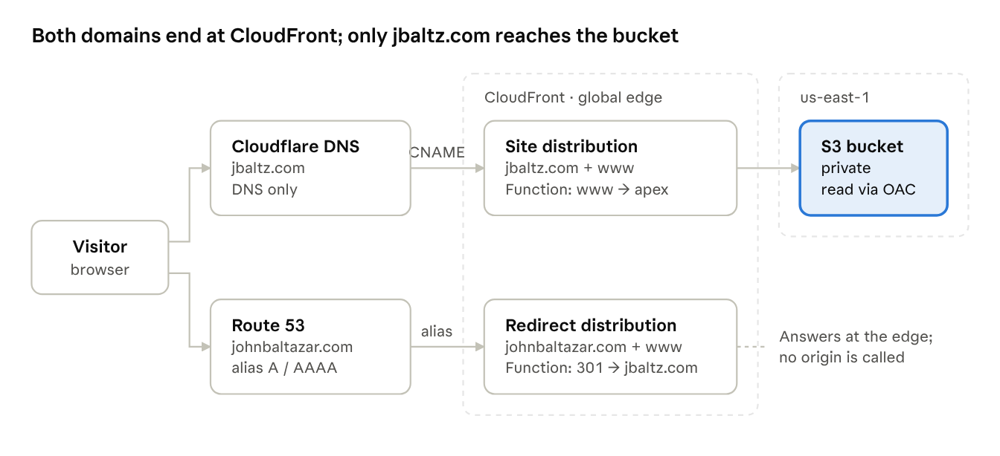

# JbaltzInfraCDK

Infrastructure for [jbaltz.com](https://jbaltz.com), written in AWS CDK
(TypeScript). Both stacks are deployed in production in `us-east-1`.



| Stack | What it runs |
| --- | --- |
| `JbaltzStaticStack` | Private S3 bucket behind CloudFront (Origin Access Control), ACM certificate, and a CloudFront Function that 301s `www.jbaltz.com` to `jbaltz.com` |
| `JBRedirectStack` | 301 redirect from `johnbaltazar.com` and `www.johnbaltazar.com` to `jbaltz.com` (own certificate, distribution, function, and Route 53 alias records) |

DNS for jbaltz.com is in Cloudflare (DNS only, not proxied) and is managed by
hand. DNS for johnbaltazar.com is a Route 53 hosted zone; CDK manages its alias
records.

## Setup

```sh
cp .env.example .env   # then set AWS_ACCOUNT_ID to your 12-digit account ID
npm ci
npx cdk diff           # diffs both stacks; expect "There were no differences"
```

## Useful commands

* `npm run build`   type-check the project
* `npm run watch`   watch for changes and type-check
* `npm run test`    run the jest unit tests
* `npx cdk synth`   synthesize the CloudFormation templates
* `npx cdk diff`    compare both stacks with what is deployed
* `npx cdk deploy <stack>` (or `--all`)  deploy to the account in `.env`

## Deploying site content

The files in `site/` are not deployed by CDK. Upload them and clear the cache:

```sh
aws s3 sync site/ s3://<bucket>/ --delete
aws cloudfront create-invalidation --distribution-id <id> --paths '/*'
```

The bucket name is generated by CDK; find it, and the distribution ID, in the
`JbaltzStaticStack` resources. Bucket versioning keeps overwritten or deleted
files for 7 days.
